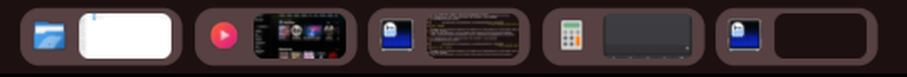
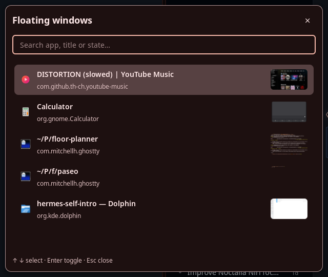

# stashpad

Stash floating windows out of sight on niri + [Noctalia](https://noctalia.dev), with live thumbnails in the top bar.

Press `Super+S` on a floating window and it *slides up behind the bar and vanishes*. Its app icon and a live thumbnail stay as a pill in the bar. Press `Super+S` again (or click the pill) and it *slides back down* exactly where it was.



Built as a Noctalia plugin (Luau: bar widget + searchable picker panel + a service that owns the backend) around a Python backend that talks to niri over its IPC socket and captures window thumbnails via niri's `org.gnome.Mutter.ScreenCast` D-Bus API. No compositor patches, no external layer-shell clients — everything rides documented APIs.

## How it works

- **Stash**: the window is moved to the top screen edge with niri's own `window-movement` spring (that's the slide), then — ~300 ms later — teleported to a dedicated named workspace `"shelf"` that this tool injects into your niri config *only while stashes exist*. Niri deletes it when it empties.
- **Summon**: teleport back to a real workspace (it lands at the parked top-edge coordinates) and niri animates the final move — a slide down from behind the bar. The bar (44 px) covers the clamp sliver, so windows appear to emerge from / vanish into the bar itself.
- **Thumbnails**: each stash (and every content change bump) re-captures the window through the Screencast API; the pill shows the cached image.
- **Picker** (`Super+Shift+S`): searchable panel — app, title, `stashed`/`visible` filters; rows toggle the same way, sorted most-recently-viewed first (a visible window is marked with an eye):

  

niri has no hidden workspaces and no minimize (the clamp keeps ~39 px of any mapped window visible, and floats render above tiling), so a self-managing workspace is what makes stashes *actually* invisible — and the slide choreography is what keeps them feeling physical.

## Keybinds (mine; wire them up as you like)

niri `config.kdl`:

```kdl
binds {
    Mod+S repeat=false hotkey-overlay-title="Stash floating / summon recent shelf window" { spawn "python3" "/path/to/stashpad/shelf.py" "toggle"; }
    Mod+Shift+S repeat=false hotkey-overlay-title="Search floating shelf" { spawn "noctalia" "msg" "panel-toggle" "oal/edge-shelf-trial:picker"; }
    Mod+Left  cooldown-ms=150 { spawn "python3" "/path/to/stashpad/shelf.py" "cycle" "left"; }
    Mod+Right cooldown-ms=150 { spawn "python3" "/path/to/stashpad/shelf.py" "cycle" "right"; }
}
```

`toggle` stashes the focused window, or summons the most recently used stashed one. Clicking a bar pill toggles that specific window either direction.

`cycle` is a conditional takeover of the arrows: when the focused window is the *only visible* pad window it swaps in place with the next/previous stashed one in **slot order** (bar-pill left-to-right), wrapping — an **instant** swap (both windows move while invisible; no slide), so exactly one float stays on screen and you can mash the arrow to rotate the pad. The slide-from-the-bar animation is kept for plain stash/summon, where a float appears or vanishes on its own. In every other focus state the command instantly falls through to niri's own `focus-column-left/right`, so the keys keep their normal job (expect ~20 ms extra latency from the spawn; `cooldown-ms` keeps hold-repeat sane).

## Install

Requirements: **niri ≥ 26.x** (tested on 26.04) and **Noctalia ≥ 5.3** (plugin API 33/34).

1. Clone, then make the paths real: the four `edge-shelf-trial/*.luau` files each reference the backend with an absolute `local helper = "/…/stashpad/shelf.py"` line — set it to your checkout. (`panel-toggle` ids in your keybinds use the manifest id `oal/edge-shelf-trial`.) The Luau folder must stay named `edge-shelf-trial/` (the manifest id's slug): Noctalia path-sources resolve `<source>/<id-slug>/plugin.toml` when enabling, so a differently named folder is listed but silently never enables.
2. Register the plugin: `noctalia msg plugins source add stashpad path /path/to/stashpad` then `noctalia msg plugins enable oal/edge-shelf-trial`.
3. Add the bar widget to `~/.config/noctalia/config.toml`:

   ```toml
   [bar.default]
   start = ["workspaces", "oal/edge-shelf-trial:bar"]
   ```

   then `noctalia msg config-reload`.
4. Add the niri binds above; niri hot-reloads `config.kdl`.
5. **Recommended** — silence the "Screen Sharing Active" privacy toast for capture activity (thumbnail captures open a screencast session; real screen shares still get the toast):

   ```toml
   [shell.privacy]
   screen_filter_regex = "python3"
   ```

The backend spawns automatically as the plugin's `[[service]]`; it keeps a lock, restores stashed windows on shutdown, and self-heals state from niri on start.

## Files

| Path | What |
| --- | --- |
| `shelf.py` | backend: stash/summon choreography, shelf-workspace lifecycle, registry, preview worker, CLI |
| `capture.py` | single-window capture via niri's Mutter ScreenCast API (window-targeted, not full-screen) |
| `single_window.py` | niri IPC socket client helpers |
| `edge_shelf.py` | vendored first-generation helpers (position/BIND/state) |
| `registry.py` | registry model (slots, tokens, generations) |
| `edge-shelf-trial/` | Noctalia Luau: `bar.luau` (pills), `picker.luau` (search panel), `monitor.luau` (service), `plugin.toml` |
| `*-test.py` | offline unit tests + bounded live regression tests (they drive your real desktop; read before running) |

Runtime state lives in `registry.json` (git-ignored: it contains your **window titles** — don't commit it, and don't point backups of it at public places).

## Caveats

- The shelf workspace is a *named* workspace, so it sorts before dynamic ones and appears in overview / `Mod+Page_Up/Down` while stashes exist (it's empty-of-your-attention by design and deletes itself when drained).
- Thumbnails require niri's screencast support; captures are filtered from Noctalia's privacy toast via `screen_filter_regex` (see install step 5).
- Slots are stable ordering, not shortcuts here — pill clicks and the picker toggle directly.
- Only *floating* windows are shelf material; tiling a window releases it from the shelf.

## Ideas / upstream

- Noctalia 5.4's `[[layer]]` plugin API (API 36) will allow chromeless floating widgets — the pills could become a real edge shelf instead of bar residents.
- niri hidden workspaces (draft PR [niri-wm/niri#2997](https://github.com/niri-wm/niri/pull/2997)) would replace the dynamic-workspace trick entirely.
- A native fade is impossible on stock niri (no opacity animation; `toggle-window-rule-opacity` is an instant step) — filed nothing; the slide does the emotional work.

## License

MPL-2.0
